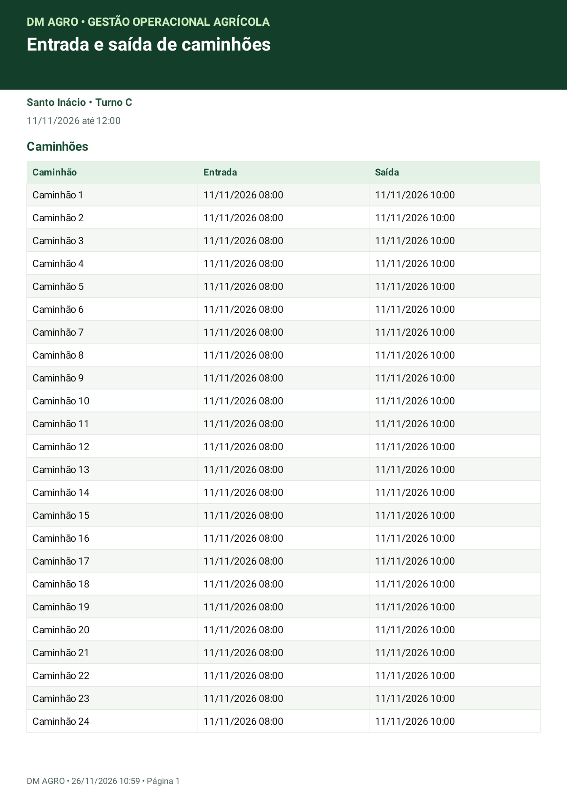

# Entrega 2 — estoque livre e PDF opcional

Desenvolvimento de 26/11/2026 na branch `dm-agro-professional-beta`, somente para nossa equipe. Continuação autorizada do [plano técnico](PLANO-TECNICO.md), sobre a [primeira etapa de segurança](ETAPA-1-EQUIPE.md). Esta entrega é parte das ferramentas do plano; não representa a conclusão da migração de persistência nem de toda a plataforma.

## Estoque

- Área e produtividade aceitam texto livre no cadastro individual e de vários lotes. Exemplos: `40 ha, aproximadamente`, `Área a conferir`, `Entre 70 e 80 t/ha`. O aplicativo não extrai um número desse texto nem arredonda o conteúdo ao enviar.
- Valores puramente numéricos continuam recebendo as unidades ha e t/ha na mensagem. Textos com unidade escrita não recebem uma unidade duplicada. O valor original permanece no registro; uma pontuação ambígua como `1.000,5` é preservada como texto, sem interpretação silenciosa.
- Observações opcionais em cada lote, com várias linhas. Elas entram no rascunho individual, na edição, no histórico de correções, na busca, na consulta do estoque e nos compartilhamentos. Apagar uma observação é uma correção registrada. Registros antigos sem esse campo continuam válidos.
- Lote, talhões, área e produtividade continuam necessários para salvar/enviar. Há limites de tamanho para evitar registros excessivos: lote 100 caracteres, talhões 2.000, área/produtividade 200 cada e observações 4.000. Não foi criado campo obrigatório de toneladas estimadas.
- O cadastro múltiplo continua aceitando até 20 lotes. Valida todos antes de gravar; um cartão incompleto não salva parcialmente os demais. Atualizar um lote existente mantém o ID e a foto, registrando as correções. Um formulário de outra frente/conta não grava depois da troca de sessão.
- Ao atualizar um lote pelo cadastro múltiplo ou por um novo formulário sem carregar o lote anterior, deixar observações em branco preserva a observação existente. Para apagá-la, abra Editar estoque, limpe o campo carregado e salve; essa remoção entra no histórico de correções.
- O envio padrão continua sendo **mensagem + fotos/mapas originais ou pintados**, com escolha de fotos por lote e possibilidade de enviar sem foto. Não há substituição por uma captura do estoque. A mensagem individual agora usa a identificação DM AGRO e informa frente/turno, com os mesmos campos de negócio.

## PDF como opção separada

- Em Preparar envio de estoques, há **Enviar mensagem e fotos** e **Enviar em PDF**. O PDF usa os lotes selecionados e respeita a escolha de omitir fotos. Um estoque individual também tem a ação PDF nas opções do lote.
- O documento de estoque tem frente, turno, data da geração, responsável, campos dos lotes e as fotos disponíveis neste aparelho. Conteúdo longo continua em outras páginas. Os dados e arquivos originais não são modificados pela exportação.
- As telas que já possuem uma composição de relatório em imagem passam a oferecer PDF no menu contextual, mantendo a imagem. Exemplos: pendências, peças, chuva, ocorrências, caminhões e O.S. A lista de estoque mantém seu envio pela seleção de lotes. Páginas sem relatório não ganham opções de exportação vazias.
- O PDF de pendências acompanha o filtro de serviços para parada de chuva e a busca por equipamento; inclui somente as pendências abertas selecionadas e suas fotos locais. O detalhe do equipamento também respeita esse filtro. O envio especializado em imagem continua com a composição anterior.
- A prévia distingue PDF de imagem. **Visualizar PDF** abre um leitor instalado; se não houver leitor, é possível enviar mesmo assim. Somente **Enviar** abre o compartilhamento Android. A autorização de sessão é conferida antes da prévia, da visualização e do envio.
- Geração em segundo plano com fila única, FileProvider do contexto da aplicação e permissão temporária de leitura. Não há API nova, serviço pago ou envio automático a contatos/grupos.

## Validação e limites

Os resultados finais desta entrega estão em [evidências verificáveis](evidencias-entrega-2.json). Há testes dos fluxos de rascunho/edição, texto livre, lote incompleto, troca de frente, seleção de fotos, composição/paginação e envio com o FileProvider real configurado no aplicativo.

Código validado: `367456c87f1e100b002f77d5f91ec77650aa911a`, sobre a implementação `ddd86e91f97cebd89b33d5a31a06a40c0a2c8f47`. [Execução no GitHub Actions](https://github.com/Diegomachadosl10/colheita-gps-oficial/actions/runs/45806031339).

| Verificação | Resultado |
| --- | --- |
| Compilação e testes Android locais | `assembleDebug` e 305 testes aprovados; zero falhas/erros/ignorados |
| Lint | Zero erros; 128 avisos, mesmo total da base auditada |
| Regras no Actions | 28 estáveis + 28 de compatibilidade + 10 Beta; todos aprovados em `demo-dm-agro` |
| Serviço e publicador no Actions | 18 e 7 testes aprovados |
| APK local | Mesmo `applicationId` e certificado fixado no repositório; nenhuma distribuição |

Robolectric não executa o gravador nativo de PDF do Android. Os testes de composição capturam as chamadas de páginas/Canvas; os testes de URI e confirmação usam um PDF sintético válido e verificam MIME, bytes e permissões de leitura. Isso **não é homologação do PDF final no Android físico ou no WhatsApp real**. Essa homologação continua necessária antes de disponibilizar o Beta.

O PDF de estoque é um relatório visual; uma foto de mapa dentro dele não o transforma em GeoPDF. O PDF original, sua georreferência, pinturas e cálculos não foram alterados. Exportar o mapa pintado preservando os metadados geográficos continua pendente.

Prévia em PNG do mesmo compositor, com registros fictícios de caminhões, conferida visualmente durante a validação:

O módulo de relatórios de turno, indicadores novos, catálogo editável de frentes/turnos, persistência transacional/migração, IA e revisão visual completa ainda não foram entregues. Notificações e servidor do Beta, assinatura no CI e canal opt-in continuam pendentes conforme a etapa anterior. Outras empresas e cobranças permanecem fora desta fase.

Nenhuma regra/Worker foi implantado, nenhum dado real foi migrado e nenhum APK foi distribuído. A produção continua na versão 2.2.7. A versão interna do Beta permanece 2.3.0/código 39 até a preparação do canal e a coordenação da numeração de atualizações.
